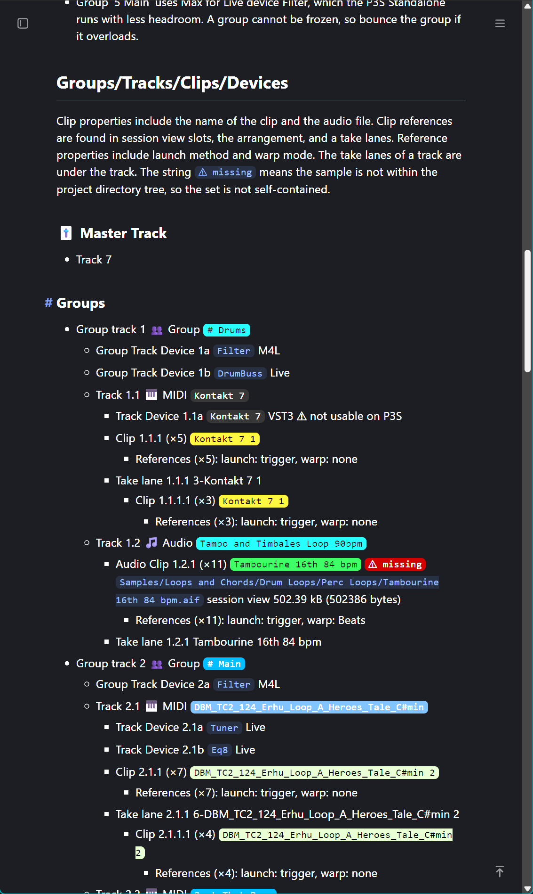

# Collapsible Nested Lists

## Requirement

The portion of the current output of `als_report` that deals with hierarchical
lists is:



I want to be able to collapse nested markdown lists. All items should start
open, user action is required to collapse them. For example:

```markdown
* item 1
* item 2
  * item 2.1
  * item 2.2
    * item 2.2.1
    * item 2.2.2
    * item 2.2.3
  * item 2.3
* item 3
  * item 3.1
* item 4
```

## Solution

Standard Markdown can indent nested bullets, but it doesn't support users
collapsing them. Because markdown processors pass through html unchanged, we
generate this portion of the `als_report` markdown output as HTML.

To make nested lists collapsible, use HTML `<details>` and `<summary>`
elements. Writing the whole list as HTML, with no Markdown inside, avoids
differences in how Markdown processors handle Markdown nested inside HTML. No
CSS or JavaScript is required.

```html
<ul style="list-style: none; padding-left: 12pt;">
  <li>1. This is the top level blah</li>
  <li style="list-style: none;">
    <details open>
      <summary>1.1 Sublevel Blah</summary>
      <ul style="list-style: none;">
        <li>1.1 blah</li>
        <li style="list-style: none;">
          <details open>
            <summary>1.2 blah</summary>
            <ul style="list-style: none; padding-left: 12pt;">
              <li>2.2.1 blah</li>
              <li>2.2.2 blah</li>
              <li>2.2.3 blah</li>
            </ul>
          </details>
        </li>
        <li>2.3 blah</li>
      </ul>
    </details>
  </li>
  <li style="list-style: none;">
    <details closed>
      <summary>3  <i>click me to open</i></summary>
      <ul style="list-style: none; padding-left: 12pt;">
        <li>3.1 blah</li>
      </ul>
    </details>
  </li>
  <li>4 blah</li>
</ul>
```

Renders as:

<ul style="list-style: none; padding-left: 12pt;">
  <li>1. This is the top level blah</li>
  <li>
    <details open>
      <summary>1.1 Sublevel Blah</summary>
      <ul style="list-style: none;">
        <li>1.1 blah</li>
        <li style="list-style: none;">
          <details open>
            <summary>1.2 blah</summary>
            <ul style="list-style: none; padding-left: 12pt;">
              <li>2.2.1 blah</li>
              <li>2.2.2 blah</li>
              <li>2.2.3 blah</li>
            </ul>
          </details>
        </li>
        <li>2.3 blah</li>
      </ul>
    </details>
  </li>
  <li>
    <details closed>
      <summary>3  <i>click me to open</i></summary>
      <ul style="list-style: none; padding-left: 12pt;">
        <li>3.1 blah</li>
      </ul>
    </details>
  </li>
  <li>4 blah</li>
</ul>


Notes:

- Every `<ul>` and every `<li>` that contains a <details> needs `list-style: none;`. The
  `<ul>` elements keep their default left padding, so the indentation still shows
  the hierarchy.
- All items start collapsed by default. Add `open` to a `<details>` tag
  (`<details open>`) to start it expanded. Mike prefers writing `<details
  closed>` to `<details>`.
- Only items with children use `<details>`; leaf items are plain `<li>`. In most
  browsers, a collapsible item shows both the list bullet and the disclosure
  triangle, and leaf text is not aligned with summary text. Inline CSS can
  adjust this if needed.
- Blank lines should not appear within the '<ul>...</ul>` block. Some processors
  end an HTML block at a blank line and then treat the remaining indented lines
  as a code block.
- To remove the triangle as well, add `style="list-style: none;"` to each `<summary>`.
  This works in current Firefox, Chrome and Edge. Safari versions before 18 need
  the `::-webkit-details-marker` pseudo-element, which cannot be set inline, so the
  triangle remains there. Without the triangle, nothing indicates which items
  collapse, except any text you add such as “click me to open”.


### Behavior by viewer

No markup works in every viewer. This HTML degrades without losing content:

- **Current browsers (Chrome, Firefox, Safari, Edge):** `<details>` and
  `<summary>` are supported, so the lists collapse. No JavaScript or CSS is
  required.
- **Browsers without `<details>` support (Internet Explorer 11, legacy
  Edge):** the unrecognized elements are ignored and all content is shown
  expanded. The list stays readable but does not collapse.
- **Markdown renderers that pass HTML through (GitHub, for example):**
  `<details>`, `<summary>`, `<ul>` and `<li>` are allowed, so the lists
  collapse. A renderer with a stricter HTML sanitizer may strip the tags,
  leaving the text as a flattened or unindented list. This is desirable
  behavior, so we get this feature for free.


## Implementation

`lib/live_set/serializer/` contains classes for serializing
`lib/live_set/model/` classes. Each serializer class has a `to_markdown` method.

To support collapsible lists, we shall implement `to_html` methods for the
portions of the report that feature hierarchical numbers. Because HTML is passed
through unchanged by markdown processors, if a serializer's `to_html` method is
called, then all serialization classes that are invoked after that also must
have `to_html` methods, and they must be called instead of `to_markown`.

To say this another way: Although `to_markdown` and `to_html` methods may call
`to_html` methods, no `to_html` method may call a `to_markdown` method.

As with `to_markdown` methods, each new `to_html` leaf serialization class
renders the leaf model class instance passed to it. Serialization classes that
receive collections of model classes shall delegate the rendering of their
colleciton items to a corresponding leaf renderer.

### Collection Serializers

The essence of each collection class serializer is to output something like:

```html
<details open>
  <summary>1.1 Sublevel Blah</summary>
  <ul style="list-style: none;">
    #{children.each(&:to_html).join("\n"-)}
  </ul>
</details>
```


### Summary

Every serialization class that outputs a hierarchical number must be
collapsible, which means it must have a `to_html` method. At least the following
leaf serialization classes require a `to_html` method:
DeviceCrossReferenceSerializer, LiveAudioTrackSerializer, LiveDeviceSerializer,
LiveGroupSerializer, LiveHeaderSerializer, LiveMasterTrackSerializer,
LiveMidiClipGroups, LiveMidiTrackSerializer, LivePackSerializer (TODO write
this), LiveProjectInfoSerializer, LiveReturnTrackSerializer, LiveSizesSerializer
(TODO rename this class because it does not deal with collecitons. call it
 LiveSizeSerializer), LiveSampleSerializer, LiveTakeLaneSerializer,
LiveTakeLanesSerializer, LiveTrackCollectionSerializer,  P3SCompatibility, TrackClipCrossReferenceSerializer

The following collection serializer classes also require a `to_html` method:
LiveAssetsSerializer, LiveAudioClipsSerializer, LiveAudioClipsSerializer,
LiveAudioTracksSerializer, LiveDevicesSerializer, LiveGroupsSerializer,
LiveMidiClipSerializer, LiveMidiTracksSerializer, LivePacksSerializer,
LiveReturnTracksSerializer, LiveSamplesSerializer, LiveTracksSerializer,
MissingSamplesSerializer


### Claude Said

*Claude did not look at existing code before generating the following. Consider
this a rough outline, not a complete specification.*

Below is a section to append to the end of the document. I used `<code>` for the
badges and omitted the group and track icons, because the screenshot does not
show the HTML behind them. Replace these with whatever the serializers emit.
Group tracks and tracks start open. Clips and take lanes start collapsed.

#### Mockup

The mockup in the next section follows the hierarchy in the above screenshot.
Rules applied:

- Every `<ul>` has `list-style: none;` and an reduction in `left-padding`.
- Every `<li>` that contains a `<details>` has `list-style: none;` and an reduction in `left-padding`.
- Items with children (group track, track, clip, take lane) use `<details>` and `<summary>`.
- Leaf items (group track device, track device, references) are plain `<li>`.
- The hierarchical number is part of the text, so no bullets are needed.
- The disclosure triangle is kept as the only collapse indicator.

#### Rendered HTML Mockup

*The following rendered HTML should collapse when clicked.*

<ul style="list-style: none;">
  <li style="list-style: none;">
    <details open>
      <summary>Group track 1 Group <code>Drums</code></summary>
      <ul style="list-style: none;">
        <li>Group Track Device 1a <code>Filter</code> M4L</li>
        <li>Group Track Device 1b <code>DrumBuss</code> Live</li>
        <li style="list-style: none;">
          <details open>
            <summary>Track 1.1 MIDI <code>Kontakt 7</code></summary>
            <ul style="list-style: none;">
              <li>Track Device 1.1a <code>Kontakt 7</code> VST3 not usable on P3S</li>
              <li style="list-style: none;">
                <details>
                  <summary>Clip 1.1.1 (x5) <code>Kontakt 7 1</code></summary>
                  <ul style="list-style: none;">
                    <li>References (x5): launch: trigger, warp: none</li>
                  </ul>
                </details>
              </li>
              <li style="list-style: none;">
                <details>
                  <summary>Take lane 1.1.1 3-Kontakt 7 1</summary>
                  <ul style="list-style: none;">
                    <li style="list-style: none;">
                      <details>
                        <summary>Clip 1.1.1.1 (x3) <code>Kontakt 7 1</code></summary>
                        <ul style="list-style: none;">
                          <li>References (x3): launch: trigger, warp: none</li>
                        </ul>
                      </details>
                    </li>
                  </ul>
                </details>
              </li>
            </ul>
          </details>
        </li>
        <li style="list-style: none;">
          <details open>
            <summary>Track 1.2 Audio <code>Tambo and Timbales Loop 90bpm</code></summary>
            <ul style="list-style: none;">
              <li style="list-style: none;">
                <details>
                  <summary>Audio Clip 1.2.1 (x11) <code>Tambourine 16th 84 bpm</code> <code>missing</code> <code>Samples/Loops and Chords/Drum Loops/Perc Loops/Tambourine 16th 84 bpm.aif</code> session view 502.39 kB (502386 bytes)</summary>
                  <ul style="list-style: none;">
                    <li>References (x11): launch: trigger, warp: Beats</li>
                  </ul>
                </details>
              </li>
              <li>Take lane 1.2.1 Tambourine 16th 84 bpm</li>
            </ul>
          </details>
        </li>
      </ul>
    </details>
  </li>
  <li style="list-style: none;">
    <details open>
      <summary>Group track 2 Group <code>Main</code></summary>
      <ul style="list-style: none;">
        <li>Group Track Device 2a <code>Filter</code> M4L</li>
        <li style="list-style: none;">
          <details open>
            <summary>Track 2.1 MIDI <code>DBM_TC2_124_Erhu_Loop_A_Heroes_Tale_C#min</code></summary>
            <ul style="list-style: none;">
              <li>Track Device 2.1a <code>Tuner</code> Live</li>
              <li>Track Device 2.1b <code>Eq8</code> Live</li>
              <li style="list-style: none;">
                <details>
                  <summary>Clip 2.1.1 (x7) <code>DBM_TC2_124_Erhu_Loop_A_Heroes_Tale_C#min 2</code></summary>
                  <ul style="list-style: none;">
                    <li>References (x7): launch: trigger, warp: none</li>
                  </ul>
                </details>
              </li>
              <li style="list-style: none;">
                <details>
                  <summary>Take lane 2.1.1 6-DBM_TC2_124_Erhu_Loop_A_Heroes_Tale_C#min 2</summary>
                  <ul style="list-style: none;">
                    <li style="list-style: none;">
                      <details>
                        <summary>Clip 2.1.1.1 (x4) <code>DBM_TC2_124_Erhu_Loop_A_Heroes_Tale_C#min 2</code></summary>
                        <ul style="list-style: none;">
                          <li>References (x4): launch: trigger, warp: none</li>
                        </ul>
                      </details>
                    </li>
                  </ul>
                </details>
              </li>
            </ul>
          </details>
        </li>
      </ul>
    </details>
  </li>
</ul>

#### Notes on the above mockup

- The screenshot cuts off at Track 2.2, so the mockup ends at Track 2.1.
- The `to_html` method of each serializer must emit the same `<li>`,
  `<details>`, `<summary>` and `<ul>` pattern as in this mockup.
- The long file path in the Audio Clip summary wraps in the screenshot. It is
  placed in `<summary>` here, so the whole line is the click target.

- In the "Renders as" block, the `<li>` elements that contain `<details>` lack
  `style="list-style: none;"`, so the rendered demo differs from its source.

The mockup avoids all three. Per the document's convention, paste an unfenced
copy of the mockup HTML beneath a "Renders as:" line if you want a live demo of
it.
